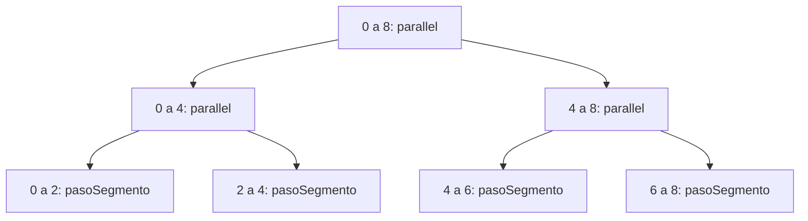

# Simulación de partículas repartida con `parallel`

## El cálculo

Un paso de la simulación mueve cada partícula según su velocidad. La función
base es `pasoSegmento`, que resuelve en secuencial el tramo entre `desde`
incluido y `hasta` excluido:

```Scala
def mover(p: Particula, dt: Double): Particula =
  Particula(p.pos + p.vel * dt, p.vel, p.masa)

def pasoSecuencial(s: Sistema, dt: Double): Sistema =
  s.map(p => mover(p, dt))

def pasoSegmento(s: Sistema, dt: Double, desde: Int, hasta: Int): Sistema =
  s.slice(desde, hasta).map(p => mover(p, dt))
```

Qué hace cada una:

- `mover` calcula la posición nueva de una partícula con la regla del
  movimiento con velocidad constante:

  ```math
  \text{posición nueva} = \text{posición} + \text{velocidad} \times dt
  ```

  La velocidad y la masa no cambian.

- `pasoSecuencial` aplica `mover` a todas las partículas del sistema, una
  detrás de otra.

- `pasoSegmento` hace lo mismo, pero solo con las partículas que van de la
  posición `desde` hasta la anterior a `hasta`. Por ejemplo,
  `pasoSegmento(s, dt, 2, 5)` mueve las partículas 2, 3 y 4 y devuelve solo
  esas tres.

La versión paralela divide el sistema a la mitad mientras el tramo pase del
umbral, y entrega las dos mitades a `parallel`:

```Scala
def pasoParalelo(s: Sistema, dt: Double, umbral: Int): Sistema = {
  val umb = math.max(umbral, 1)
  def resolver(desde: Int, hasta: Int): Sistema =
    if (hasta - desde <= umb) pasoSegmento(s, dt, desde, hasta)
    else {
      val medio = desde + (hasta - desde) / 2
      val (izq, der) = parallel(resolver(desde, medio), resolver(medio, hasta))
      izq ++ der
    }
  if (s.length <= umb) pasoSecuencial(s, dt) else resolver(0, s.length)
}
```

## La estrategia de reparto

Divide y vencerás sobre los índices. El tramo `[desde, hasta)` se parte en
`medio` en dos tramos, `[desde, medio)` y `[medio, hasta)`. Ningún índice
aparece en los dos y ninguno queda por fuera, así que ninguna partícula se
pierde ni se repite (lema de la sección 3 de `correccion.md`). Por debajo del
umbral ya no se parte y el tramo se resuelve con `pasoSegmento`. Si todo el
sistema cabe en el umbral, la guarda inicial usa `pasoSecuencial` directamente.

Las partículas son independientes. Mover una partícula solo depende de
ella misma: no hay fuerzas entre partículas en este paso. Por eso cada tramo se
calcula sin mirar los otros, los hilos solo leen `s` y escriben en arreglos
propios, y no hay condiciones de carrera.

**La combinación es la concatenación, que es asociativa.**

```math
\text{pasoSegmento}(s, dt, d, m) \mathbin{+\!\!+} \text{pasoSegmento}(s, dt, m, k)
= \text{pasoSegmento}(s, dt, d, k)
```

```math
(x \mathbin{+\!\!+} y) \mathbin{+\!\!+} z = x \mathbin{+\!\!+} (y \mathbin{+\!\!+} z)
```

Distintos umbrales agrupan las concatenaciones de forma distinta, y la
asociatividad garantiza que todos dan el mismo sistema. `++` no es conmutativa,
pero no hace falta: `parallel` devuelve `(izq, der)` en ese orden aunque `der`
termine primero, así que el orden de las partículas se conserva.

**El umbral corregido.** `umb = math.max(umbral, 1)` asegura que todo tramo de
una partícula sea una hoja. Con umbral 0 sin corregir, un tramo de tamaño 1 se
partiría en uno vacío y en sí mismo, y la recursión no terminaría.

El árbol de llamados para un sistema de ocho partículas con umbral 2 queda así,
con las hojas resolviendo en secuencial:



### Lo que se espera antes de medir

A diferencia de una suma, donde combinar dos mitades cuesta una operación, aquí
cuando se divide, combinar cuesta **copiar**: `izq ++ der` crea un arreglo nuevo con
`hasta - desde` partículas. En la raíz esa copia es de las $n$ partículas y la
hace un solo hilo, después de que terminan todas las hojas. Cada nivel del
árbol copia en total $n$ partículas, así que con $k$ particiones se copian
del orden de $k \cdot n$ partículas además del trabajo de `mover`.

Mover una partícula también es barato (dos multiplicaciones y dos sumas), así
que la relación entre cálculo y memoria es baja. Por estas dos razones se
espera una aceleración bastante menor que el número de núcleos, y que umbrales
muy pequeños empeoren el tiempo: más niveles significan más copias.

## Magnitudes globales en paralelo (punto 3)

`energiaParalela` y `centroDeMasaParalelo` usan el mismo reparto por índices
de `pasoParalelo`, con `umb = math.max(umbral, 1)`. Mientras el tramo sea
mayor que `umb`, se calculan sus mitades con `common.parallel`. Una mitad
impar tiene un elemento más; los intervalos siguen cubriendo todo el tramo.

* **Energía:** cada hoja aplica `energiaSecuencial` a su recorte. Al volver,
  se suman `izq + der`. El neutro para un tramo vacío es `0.0`.
* **Centro de masa:** cada hoja usa `foldLeft` para obtener un par
  $(Q,M)=(\sum m_i\vec r_i,\sum m_i)$. Los nodos internos suman los vectores
  y las masas. La división se hace una sola vez, después de combinar todo el
  sistema; con masa total cero se devuelve el origen.

Por ejemplo, los pares $((-8,4),2)$ y $((20,10),4)$ se combinan como
$((12,14),6)$ y dan el centro $(2,7/3)$. Promediar los centros de las mitades
daría $(0{,}5,2{,}25)$: no respeta que sus masas son diferentes.

Ambas combinaciones tienen costo constante. Sobre los reales son asociativas
(demostración en las secciones 7 y 8 de `correccion.md`); con `Double` puede
variar el redondeo al reagrupar. No se usan variables compartidas: las tareas
leen el sistema y construyen valores propios.

Las hojas copian sus segmentos con `slice`. Sus tamaños suman $n$, y cada
partícula se procesa en una sola hoja. A diferencia de `pasoParalelo`, no se
concatenan arreglos al subir por el árbol: se suman números o pares de tamaño
fijo. El trabajo total es lineal en $n$, contando también las combinaciones.
Un umbral pequeño aumenta las tareas y los recortes; un umbral grande deja
más trabajo secuencial en cada hoja. Eso explica el compromiso, pero no
determina por sí solo cuál umbral será más rápido en una máquina real.

## Estimación teórica (punto 4)

El modelo del taller toma una operación por partícula. Para $n\geq 0$,
$p>0$ y $u=\max(\text{umbral},1)$:

```math
W(n)=n, \qquad
D(n,u)=\begin{cases}
n & n\leq u,\\
1+\max(D(\lfloor n/2\rfloor,u),D(n-\lfloor n/2\rfloor,u)) & n>u,
\end{cases}
\qquad T(n,p,u)=D(n,u)+\frac{W(n)}{p}
```

`profundidad` suma el costo secuencial de la hoja del camino más costoso y
las particiones anteriores. Para tamaños impares hay que comparar **ambas**
ramas: $D(11,5)=6$ y $D(12,5)=5$, por lo que $D(23,5)=7$.
`tiempoEstimado` convierte el trabajo a `Double` antes de dividir.

Ejemplos calculados con la fórmula, en unidades de trabajo:

| $n$ | $p$ | Umbral | $W$ | $D$ | $T = D + W/p$ |
|---:|---:|---:|---:|---:|---:|
| 9 | 4 | 2 | 9 | 5 | 7,25 |
| 13 | 8 | 3 | 13 | 5 | 6,625 |
| 1024 | 4 | 1024 | 1024 | 1024 | 1280 |
| 1024 | 4 | 512 | 1024 | 513 | 769 |
| 1024 | 4 | 1 | 1024 | 11 | 267 |

Estos valores no son tiempos medidos ni predicen una aceleración exacta.
El modelo omite constantes, planificación de tareas, asignación de memoria y
copias. En particular, no incluye las concatenaciones lineales de
`pasoParalelo` descritas arriba. Tampoco supone que, con $p=1$, la fórmula
sea exactamente $W$: por definición da $D+W$. La comparación experimental
corresponde al punto 5.

## Cómo se tomaron los tiempos

La corrida de `App` del 25 de noviembre de 2026 usa cuatro rondas de pares
secuencial/paralelo por candidato. En las rondas pares recorre los candidatos
de mayor a menor y mide secuencial primero; en las impares invierte ambos
órdenes. Cada ruta se precalienta tres veces por candidato antes de las rondas.
Cada muestra usa ScalaMeter con configuración explícita:

```Scala
def muestra(cuerpo: => Sistema): Double = {
  (config(Key.exec.minWarmupRuns := 5, Key.exec.maxWarmupRuns := 10,
    Key.exec.benchRuns := 5).withWarmer(new Warmer.Default) measure {
    cuerpo.length
  }).value
}
```

`cuerpo.length` evalúa el paso completo, con sus asignaciones y copias, pero
entrega un entero al medidor en vez de conservar el arreglo resultado entre
evaluaciones. No se fuerza GC dentro del bloque. La configuración es local a
`App`: no cambia el `medir` proporcionado ni `umbralConveniente`, que sigue
usando `medir(3)`. ScalaMeter agrega sus cinco ejecuciones por muestra; la tabla
usa la mediana de las cuatro muestras, promediando las dos centrales.
MAD es la mediana de las desviaciones absolutas respecto de esa mediana.
El rango de S corresponde a los cuatro cocientes de los pares, no a un
intervalo de confianza. MAD describe dispersión, no un error estadístico certificado.

La medición con el umbral igual al tamaño del sistema sirve de control:
la guarda mínima de P1 llama directamente a `pasoSecuencial(s, dt)` cuando
`s.length <= umb`. Así se ejecuta el mismo trabajo secuencial, sin un `slice`
adicional en la raíz. Las mediciones separadas aún pueden variar por ruido.

Máquina: AMD Ryzen 5 5500U, 6 núcleos físicos, 12 procesadores lógicos
disponibles para Java y 12 161 052 672 bytes de RAM (aproximadamente 11,33 GiB).
Java 17.0.19+10, Scala 2.13.11 y ScalaMeter 0.21. Heap máximo informado por
Java: 3 040 870 400 bytes. `dt = 0.5`, sin pruebas ni monitorización concurrentes.
Antes de ejecutar solo se observó el daemon Java de Gradle (PID 22256), sin
otra instancia de `App`. Comando ejecutado desde la raíz del proyecto:

```powershell
.\gradlew.bat :app:run --offline --console=plain
```

Terminó con `BUILD SUCCESSFUL in 53s`. El aviso
`Unable to create a system terminal` no impidió obtener los resultados.
`App` genera el arreglo antes de medir y verifica con `sameElements` cada
resultado paralelo contra el secuencial fuera de los bloques medidos. Los
cuatro candidatos son $n,n/2,n/8,n/32$. No se incluye generación, verificación
ni impresión en el tiempo. Cada fila vuelve a medir su referencia secuencial.

## Las mediciones

Tiempos reales, en milisegundos. La aceleración es `tseq / tpar`.
La última columna es el cociente adimensional $W/T$ del punto 4 con $p=12$,
no un tiempo ni una predicción calibrada. Particiones indica niveles de división.

| n | Umbral | Particiones | Secuencial (ms) | Paralela (ms) | Aceleración | $W/T$ |
|---:|---:|---:|---:|---:|---:|---:|
| 500 000 | 500 000 | 0 | 44,100860 | 28,413660 | 1,552101 | 0,923077 |
| 500 000 | 250 000 | 1 | 39,577860 | 32,874930 | 1,203892 | 1,714280 |
| 500 000 | 62 500 | 3 | 34,202100 | 17,994050 | 1,900745 | 4,799862 |
| 500 000 | 15 625 | 5 | 21,450010 | 18,005600 | 1,191297 | 8,726511 |
| 1 000 000 | 1 000 000 | 0 | 53,517140 | 53,051190 | 1,008783 | 0,923077 |
| 1 000 000 | 500 000 | 1 | 64,076180 | 50,740670 | 1,262817 | 1,714283 |
| 1 000 000 | 125 000 | 3 | 54,318090 | 51,309360 | 1,058639 | 4,799931 |
| 1 000 000 | 31 250 | 5 | 53,357890 | 64,616710 | 0,825760 | 8,726892 |

| n | Umbral | MAD secuencial (ms) | MAD paralela (ms) | S mínimo | S máximo |
|---:|---:|---:|---:|---:|---:|
| 500 000 | 500 000 | 3,575320 | 13,845570 | 0,989175 | 3,087323 |
| 500 000 | 250 000 | 9,373790 | 1,813900 | 0,513251 | 1,993631 |
| 500 000 | 62 500 | 2,863740 | 9,752840 | 1,148270 | 4,253325 |
| 500 000 | 15 625 | 2,452200 | 8,304070 | 0,533018 | 4,330181 |
| 1 000 000 | 1 000 000 | 5,278210 | 9,114080 | 0,734023 | 1,746966 |
| 1 000 000 | 500 000 | 9,126990 | 4,145810 | 1,047475 | 1,497205 |
| 1 000 000 | 125 000 | 7,737190 | 7,850650 | 0,870433 | 1,339680 |
| 1 000 000 | 31 250 | 11,209660 | 8,949750 | 0,576005 | 1,143996 |

El menor tiempo paralelo observado fue con umbral **62 500** para 500 000
partículas y **500 000** para un millón. Son mínimos de esta corrida, no
umbrales estables validados. Para 500 000, la diferencia entre 62 500 y
15 625 es solo 0,011550 ms, mucho menor que sus MAD; no distingue un ganador.
Se compara el tiempo paralelo absoluto,
como hace `umbralConveniente`, y no el mayor cociente contra referencias
secuenciales que también fluctúan. No se repite toda la búsqueda en `App`:
reutiliza las mediciones ya obtenidas para identificar el mínimo.

## Lo que dicen los números

El modelo mejora al bajar el umbral: para un millón y $u=125000$,
$D=125003$ y $T=125003+1000000/12=208336{,}333333$ unidades de trabajo.
El tiempo medido fue 51,309360 ms. No se pueden restar ni igualar esas cifras:
haría falta calibrar el costo por operación y agregar el costo de memoria.
El cociente $W/T=4{,}799931$ permite comparar tendencias sin mezclar unidades.
Además, para el control el modelo da $T=n+n/p$, no $n$, por lo que tampoco
su cociente de control tiene por qué ser uno.

En un millón, las medianas con uno, tres y cinco niveles fueron 50,740670,
51,309360 y 64,616710 ms: el mínimo observado no corresponde al mayor $W/T$.
En 500 000, tres y cinco niveles dan medianas casi iguales. La planificación, los recortes y las
concatenaciones añaden trabajo que el modelo omite. En particular, cada nivel
copia referencias y la concatenación de la raíz es serial. Estas propiedades
del código explican un límite de escalamiento; esta corrida no aísla cuánto
cuesta cada una.

Los controles ejecutan la misma ruta secuencial. El de un millón da
**1,008783**: la diferencia de medianas, 0,465950 ms, es pequeña frente a las
MAD de 5,278210 y 9,114080 ms; resulta compatible descriptivamente con S cerca
de uno, pero su rango 0,734023..1,746966 sigue siendo amplio. El de 500 000
da **1,552101**, no una razón cercana a uno: su MAD paralela es 13,845570 ms
y el rango es 0,989175..3,087323. Aunque incluye uno, eso no valida estabilidad.
**El control de 500 000 permanece sin validar; no se declara P5 experimentalmente
validado en conjunto.** Ningún control representa una ganancia por paralelismo.

El balanceo elimina el orden fijo anterior, pero no toda variación temporal.
No se midieron pausas de GC, temperatura ni carga externa durante la ejecución;
su causa sigue sin determinarse. Esta corrida completa sustituye los resultados
primarios anteriores, sin normalizar controles a uno ni repetir para buscar
cocientes favorables. No permite afirmar aceleración estable ni un umbral universal.

### Lectura con la ley de Amdahl

Si se supone $S=1/(f+(1-f)/p)$, la fracción serial efectiva es:

```math
f=\frac{1/S-1/p}{1-1/p}.
```

Con el menor tiempo de un millón, $S=64{,}076180/50{,}740670=1{,}262817$
y $p=12$, resulta $f\approx0{,}772960$, con techo algebraico
$1/f\approx1{,}293727$. Es una estimación efectiva descriptiva de esa fila,
no una medición de que el 77,30 % del programa sea estrictamente serial ni
un techo de rendimiento validado, dada la dispersión observada. Supone procesadores
equivalentes y una carga fija; los 12 hilos lógicos comparten 6 núcleos físicos.
El sobrecosto paralelo, la memoria, el GC y las referencias variables violan
la idealización. Las filas con $S<1$ darían $f>1$: indican ralentización y
que ese ajuste simple no representa una fracción física válida. Por eso el
techo calculado no se extrapola a otros tamaños, umbrales o máquinas.
