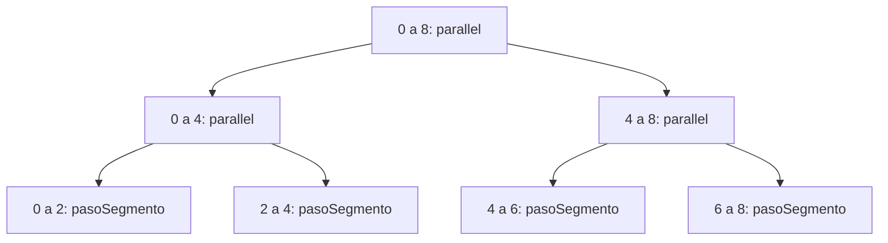

# Simulación de partículas repartida con `parallel`

## El cálculo

Un paso de la simulación mueve cada partícula según su velocidad. La función
base es `pasoSegmento`, que resuelve en secuencial el tramo entre `desde`
incluido y `hasta` excluido:

```Scala
def mover(p: Particula, dt: Double): Particula =
  Particula(p.pos + p.vel * dt, p.vel, p.masa)

def pasoSecuencial(s: Sistema, dt: Double): Sistema =
  s.map(p => mover(p, dt))

def pasoSegmento(s: Sistema, dt: Double, desde: Int, hasta: Int): Sistema =
  s.slice(desde, hasta).map(p => mover(p, dt))
```

Qué hace cada una:

- `mover` calcula la posición nueva de una partícula con la regla del
  movimiento con velocidad constante:

  ```math
  \text{posición nueva} = \text{posición} + \text{velocidad} \times dt
  ```

  La velocidad y la masa no cambian.

- `pasoSecuencial` aplica `mover` a todas las partículas del sistema, una
  detrás de otra.

- `pasoSegmento` hace lo mismo, pero solo con las partículas que van de la
  posición `desde` hasta la anterior a `hasta`. Por ejemplo,
  `pasoSegmento(s, dt, 2, 5)` mueve las partículas 2, 3 y 4 y devuelve solo
  esas tres.

La versión paralela divide el sistema a la mitad mientras el tramo pase del
umbral, y entrega las dos mitades a `parallel`:

```Scala
def pasoParalelo(s: Sistema, dt: Double, umbral: Int): Sistema = {
  val umb = math.max(umbral, 1)
  def resolver(desde: Int, hasta: Int): Sistema =
    if (hasta - desde <= umb) pasoSegmento(s, dt, desde, hasta)
    else {
      val medio = desde + (hasta - desde) / 2
      val (izq, der) = parallel(resolver(desde, medio), resolver(medio, hasta))
      izq ++ der
    }
  resolver(0, s.length)
}
```

## La estrategia de reparto

Divide y vencerás sobre los índices. El tramo `[desde, hasta)` se parte en
`medio` en dos tramos, `[desde, medio)` y `[medio, hasta)`. Ningún índice
aparece en los dos y ninguno queda por fuera, así que ninguna partícula se
pierde ni se repite (lema de la sección 3 de `correccion.md`). Por debajo del
umbral ya no se parte y el tramo se resuelve con `pasoSegmento`.

Las partículas son independientes. Mover una partícula solo depende de
ella misma: no hay fuerzas entre partículas en este paso. Por eso cada tramo se
calcula sin mirar los otros, los hilos solo leen `s` y escriben en arreglos
propios, y no hay condiciones de carrera.

**La combinación es la concatenación, que es asociativa.**

```math
\text{pasoSegmento}(s, dt, d, m) \mathbin{+\!\!+} \text{pasoSegmento}(s, dt, m, k)
= \text{pasoSegmento}(s, dt, d, k)
```

```math
(x \mathbin{+\!\!+} y) \mathbin{+\!\!+} z = x \mathbin{+\!\!+} (y \mathbin{+\!\!+} z)
```

Distintos umbrales agrupan las concatenaciones de forma distinta, y la
asociatividad garantiza que todos dan el mismo sistema. `++` no es conmutativa,
pero no hace falta: `parallel` devuelve `(izq, der)` en ese orden aunque `der`
termine primero, así que el orden de las partículas se conserva.

**El umbral corregido.** `umb = math.max(umbral, 1)` asegura que todo tramo de
una partícula sea una hoja. Con umbral 0 sin corregir, un tramo de tamaño 1 se
partiría en uno vacío y en sí mismo, y la recursión no terminaría.

El árbol de llamados para un sistema de ocho partículas con umbral 2 queda así,
con las hojas resolviendo en secuencial:



### Lo que se espera antes de medir

A diferencia de una suma, donde combinar dos mitades cuesta una operación, aquí
combinar cuesta **copiar**: `izq ++ der` crea un arreglo nuevo con
`hasta - desde` partículas. En la raíz esa copia es de las $n$ partículas y la
hace un solo hilo, después de que terminan todas las hojas. Cada nivel del
árbol copia en total $n$ partículas, así que con $k$ particiones se copian
del orden de $k \cdot n$ partículas además del trabajo de `mover`.

Mover una partícula también es barato (dos multiplicaciones y dos sumas), así
que la relación entre cálculo y memoria es baja. Por estas dos razones se
espera una aceleración bastante menor que el número de núcleos, y que umbrales
muy pequeños empeoren el tiempo: más niveles significan más copias.

## Cómo se tomaron los tiempos

> **Pendiente (punto 5).** Se completa cuando `App.scala` mida
> `pasoSecuencial` y `pasoParalelo` sobre un sistema de al menos un millón de
> partículas con `medir`, y estén implementadas `aceleracion` y
> `umbralConveniente`.

Cada cifra sale de ScalaMeter: `withWarmer(new Warmer.Default) measure { ... }`
ejecuta el bloque hasta que la máquina virtual se estabiliza y solo entonces
mide. Cada tiempo es la mediana de varias mediciones (`medir`).

```Scala
def medir[A](repeticiones: Int)(cuerpo: => A): Double = {
  val muestras = Vector.fill(repeticiones) {
    (withWarmer(new Warmer.Default) measure { cuerpo }).value
  }
  muestras.sorted.apply(muestras.length / 2)
}
```

La medición con el umbral igual al tamaño del sistema sirve de control: ahí
`pasoParalelo` no parte nada, su única hoja es `pasoSegmento(s, dt, 0, n)` y
su tiempo tiene que ser el de `pasoSecuencial`.

Máquina: _(núcleos, procesador, memoria)_.

## Las mediciones

> **Pendiente (punto 5).**

Con el umbral fijo, según el tamaño del sistema:

| n | Secuencial (ms) | Paralela (ms) | Aceleración |
|---:|---:|---:|---:|
| 1 000 000 | | | |
| … | | | |

Con el sistema fijo, según el umbral (la primera fila es el control):

| Umbral | Particiones | Paralela (ms) | Aceleración | Aceleración estimada |
|---:|---:|---:|---:|---:|
| $n$ | 0 | | ≈ 1 | |
| … | | | | |

## Lo que dicen los números

> **Pendiente (punto 5).** Comparar el tiempo estimado del punto 4
> (`tiempoEstimado`) con el medido: en qué se parecen, en qué no y a qué se
> atribuye. Comprobar si se cumple lo esperado arriba: el costo de las copias
> de `++` y la parte en serie de la concatenación en la raíz.
