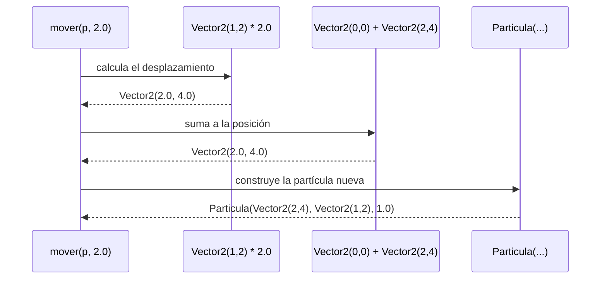
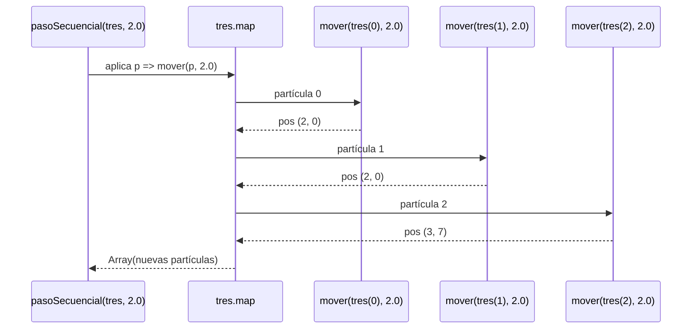
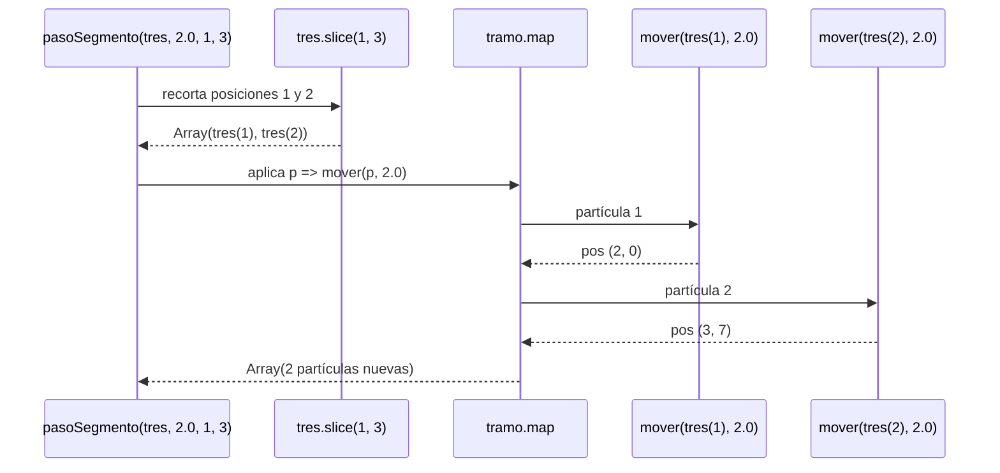
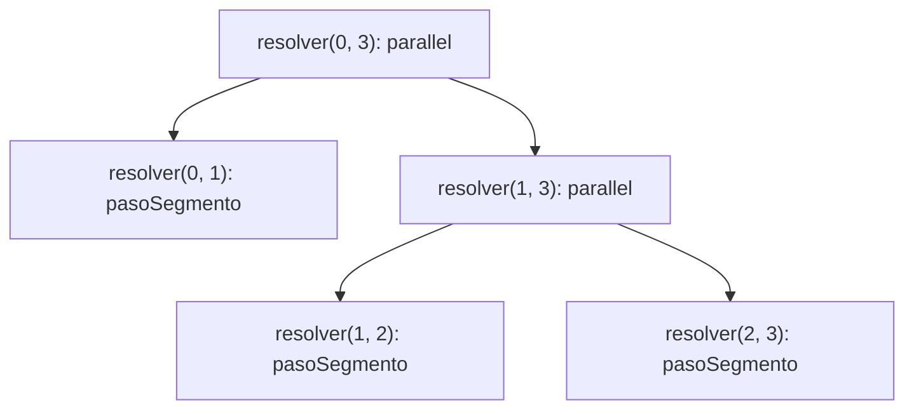
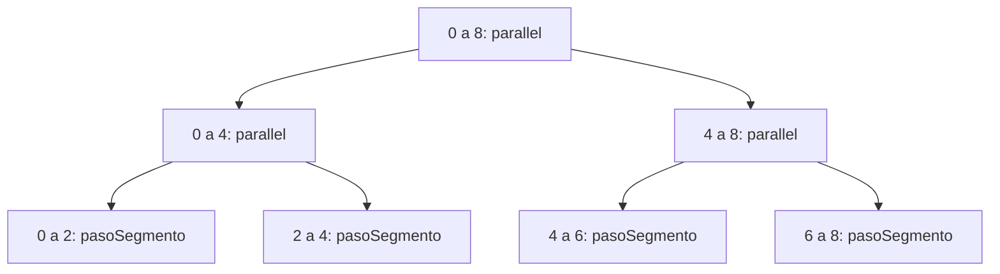
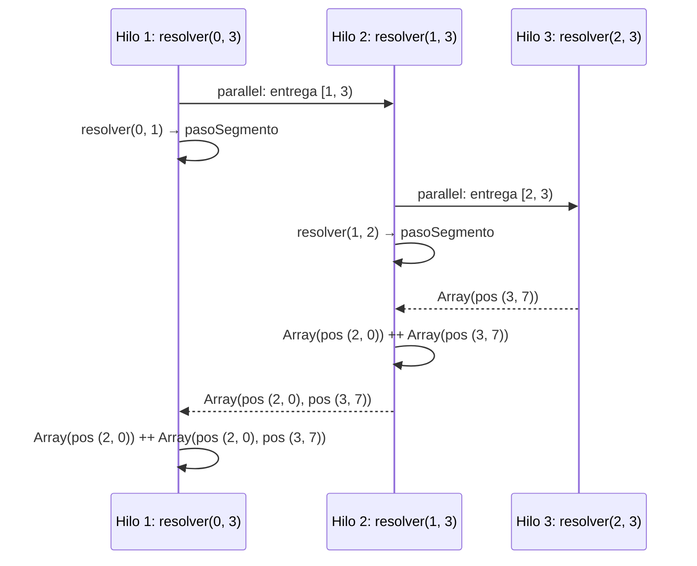
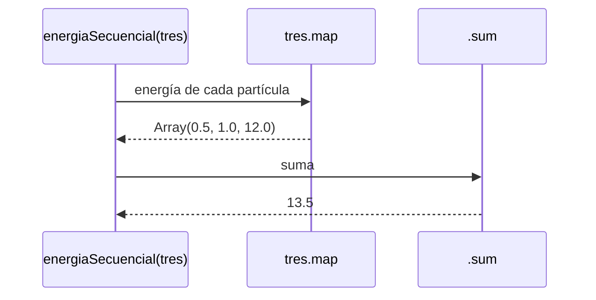
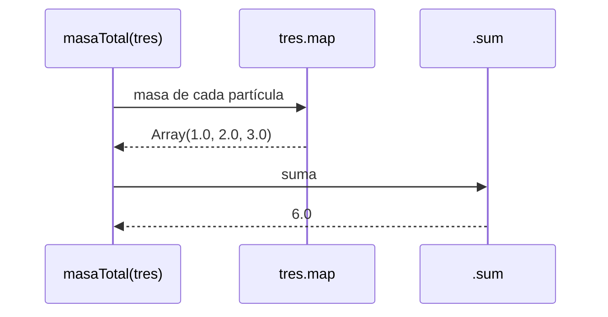

# Informe de proceso

## 1. `mover`

### Definición del algoritmo

```scala
def mover(p: Particula, dt: Double): Particula = {
  Particula(p.pos + p.vel * dt, p.vel, p.masa)
}
```

* La función `mover` calcula dónde queda una partícula después de un intervalo
  de tiempo `dt`.
* Recibe dos parámetros:

  * `p`: la partícula, con su posición `pos`, su velocidad `vel` y su `masa`.
  * `dt`: el intervalo de tiempo que avanza la simulación.
* No modifica `p`: construye una partícula nueva. La posición cambia; la
  velocidad y la masa se copian tal cual.
* La función no es recursiva: es una sola expresión que se evalúa en un
  número fijo de pasos, sin importar los datos de entrada.

### Explicación paso a paso

La posición nueva sigue la ecuación del movimiento rectilíneo uniforme:

```math
\vec{p}\,' = \vec{p} + \vec{v} \cdot dt
```

Las operaciones `+` y `*` son métodos de `Vector2`, definidos en `Modelo.scala`:

```scala
def +(o: Vector2): Vector2 = Vector2(x + o.x, y + o.y)
def *(k: Double): Vector2 = Vector2(x * k, y * k)
```

Por la precedencia de operadores de Scala, `*` se evalúa antes que `+`:

```scala
p.pos + p.vel * dt   ==   p.pos.+(p.vel.*(dt))
```

Entonces, la evaluación ocurre en este orden:

1. `p.vel * dt`: se escala la velocidad por el tiempo (el desplazamiento).
2. `p.pos + (...)`: se suma el desplazamiento a la posición.
3. `Particula(...)`: se construye la partícula nueva con la posición nueva,
   la misma velocidad y la misma masa.

---

### Evaluación con el modelo de sustitución

Ejemplo:

```scala
val p = Particula(Vector2(0, 0), Vector2(1, 2), 1.0)
mover(p, 2.0)
```

#### Paso 1: Llamada inicial

```scala
mover(Particula(Vector2(0, 0), Vector2(1, 2), 1.0), 2.0)
```

#### Paso 2: Se reemplaza el cuerpo de la función

```scala
Particula(Vector2(0, 0) + Vector2(1, 2) * 2.0, Vector2(1, 2), 1.0)
```

#### Paso 3: Se evalúa `*` (desplazamiento)

```scala
Vector2(1, 2) * 2.0  →  Vector2(1 * 2.0, 2 * 2.0)  →  Vector2(2.0, 4.0)
```

#### Paso 4: Se evalúa `+` (posición nueva)

```scala
Vector2(0, 0) + Vector2(2.0, 4.0)  →  Vector2(0 + 2.0, 0 + 4.0)  →  Vector2(2.0, 4.0)
```

#### Paso 5: Se construye la partícula resultado

```scala
Particula(Vector2(2.0, 4.0), Vector2(1, 2), 1.0)
```

---

### Pila de llamados

Como `mover` no es recursiva, la pila nunca crece más allá de tres niveles:
la llamada a `mover`, y dentro de ella, una llamada a `*` y luego una a `+`.
Cada una termina antes de que empiece la siguiente.



---

### Ejemplo de uso

```scala
val p = Particula(Vector2(0, 0), Vector2(1, 2), 1.0)
val q = mover(p, 2.0)
println(q.pos)  // Vector2(2.0,4.0)
println(p.pos)  // Vector2(0.0,0.0), p no cambió
```

El resultado de `mover(p, 2.0)` es una partícula en `(2, 4)` con la misma
velocidad `(1, 2)` y la misma masa `1.0`. La partícula original sigue igual.

---

## 2. `pasoSecuencial`

### Definición del algoritmo

```scala
def pasoSecuencial(s: Sistema, dt: Double): Sistema = {
  s.map(p => mover(p, dt))
}
```

* La función `pasoSecuencial` avanza todo el sistema un intervalo de
  tiempo `dt`.
* Recibe dos parámetros:

  * `s`: el sistema, que es un `Array[Particula]`.
  * `dt`: el intervalo de tiempo.
* Usa `map`, que aplica una función a cada elemento del arreglo y devuelve un
  arreglo nuevo del mismo tamaño, con los resultados en el mismo orden.
* La función que se aplica es la lambda `p => mover(p, dt)`: "a cada
  partícula `p`, muévela `dt`". Por eso `pasoSecuencial` reutiliza `mover`.
* No modifica `s`: el arreglo original queda igual.

### Explicación paso a paso

`map` se comporta como si recorriera el arreglo de izquierda a derecha:

1. Toma la partícula en la posición `0` y la mueve.
2. Toma la partícula en la posición `1` y la mueve.
3. … y así hasta la última.
4. Pone los resultados en un arreglo nuevo, en el mismo orden.

Si `s` está vacío no hay nada que recorrer y el resultado es un arreglo vacío.

Todo esto ocurre en un solo hilo, una partícula después de otra. Por eso
se llama secuencial: el número de pasos crece con el número de partículas
$n$.

---

### Evaluación con el modelo de sustitución

Ejemplo:

```scala
val tres: Sistema = Array(
  Particula(Vector2(0, 0), Vector2(1, 0), 1.0),
  Particula(Vector2(2, 2), Vector2(0, -1), 2.0),
  Particula(Vector2(-1, 3), Vector2(2, 2), 3.0))

pasoSecuencial(tres, 2.0)
```

#### Paso 1: Llamada inicial

```scala
pasoSecuencial(tres, 2.0)
```

#### Paso 2: Se reemplaza el cuerpo de la función

```scala
tres.map(p => mover(p, 2.0))
```

#### Paso 3: `map` aplica `mover` a cada partícula

```scala
Array(
  mover(Particula(Vector2(0, 0),  Vector2(1, 0),  1.0), 2.0),
  mover(Particula(Vector2(2, 2),  Vector2(0, -1), 2.0), 2.0),
  mover(Particula(Vector2(-1, 3), Vector2(2, 2),  3.0), 2.0))
```

#### Paso 4: Se evalúa cada `mover` (como en la sección 1)

```scala
(0, 0)  + (1, 0)  * 2.0  =  (0, 0)  + (2, 0)   =  (2, 0)
(2, 2)  + (0, -1) * 2.0  =  (2, 2)  + (0, -2)  =  (2, 0)
(-1, 3) + (2, 2)  * 2.0  =  (-1, 3) + (4, 4)   =  (3, 7)
```

#### Paso 5: Resultado

```scala
Array(
  Particula(Vector2(2, 0), Vector2(1, 0),  1.0),
  Particula(Vector2(2, 0), Vector2(0, -1), 2.0),
  Particula(Vector2(3, 7), Vector2(2, 2),  3.0))
```

Mismo tamaño (3), mismo orden (masas 1, 2, 3), velocidades y masas iguales;
solo cambiaron las posiciones.

---

### Diagrama de llamados

`map` llama a `mover` una vez por partícula, una después de otra. Cada llamado
termina antes de que empiece el siguiente, así que la pila no crece con el
tamaño del sistema.



---

### Ejemplo de uso

```scala
val r = pasoSecuencial(tres, 2.0)
println(r.map(_.pos).toList)     // List(Vector2(2.0,0.0), Vector2(2.0,0.0), Vector2(3.0,7.0))
println(tres.map(_.pos).toList)  // List(Vector2(0.0,0.0), Vector2(2.0,2.0), Vector2(-1.0,3.0)), tres no cambió
```

---

## 3. `pasoSegmento`

### Definición del algoritmo

```scala
def pasoSegmento(s: Sistema, dt: Double, desde: Int, hasta: Int): Sistema = {
  s.slice(desde, hasta).map(p => mover(p, dt))
}
```

* La función `pasoSegmento` avanza un intervalo `dt` solo un tramo del
  sistema y devuelve únicamente ese tramo.
* Recibe cuatro parámetros:

  * `s`: el sistema completo, un `Array[Particula]`.
  * `dt`: el intervalo de tiempo.
  * `desde`: la posición donde empieza el tramo (incluida).
  * `hasta`: la posición donde termina el tramo (excluida).
* El resultado tiene `hasta - desde` partículas. Si `desde == hasta`, el
  tramo es vacío y el resultado también.
* Es el bloque con el que se construye `pasoParalelo`: cada hilo resuelve un
  tramo con `pasoSegmento` y luego se pegan los resultados.
* No modifica `s`.

### Explicación paso a paso

La función hace dos cosas, una después de la otra:

1. `s.slice(desde, hasta)`: recorta el arreglo y se queda con las partículas
   en las posiciones `desde`, `desde + 1`, …, `hasta - 1`. Es un arreglo
   nuevo; `s` no cambia.
2. `.map(p => mover(p, dt))`: mueve cada partícula del recorte, igual que
   `pasoSecuencial` (sección 2), pero solo sobre el tramo.

Es decir, `pasoSegmento(s, dt, desde, hasta)` es lo mismo que
`pasoSecuencial(s.slice(desde, hasta), dt)`.

Si `desde` o `hasta` se salen del arreglo, `slice` los ajusta a los bordes en
vez de fallar, y si `hasta <= desde` devuelve un arreglo vacío.

---

### Evaluación con el modelo de sustitución

Ejemplo, con el sistema `tres` de la sección 2:

```scala
pasoSegmento(tres, 2.0, 1, 3)
```

#### Paso 1: Llamada inicial

```scala
pasoSegmento(tres, 2.0, 1, 3)
```

#### Paso 2: Se reemplaza el cuerpo de la función

```scala
tres.slice(1, 3).map(p => mover(p, 2.0))
```

#### Paso 3: Se evalúa `slice` (posiciones 1 y 2; la 0 queda fuera)

```scala
Array(
  Particula(Vector2(2, 2),  Vector2(0, -1), 2.0),
  Particula(Vector2(-1, 3), Vector2(2, 2),  3.0)).map(p => mover(p, 2.0))
```

#### Paso 4: `map` aplica `mover` a cada partícula del tramo

```scala
Array(
  mover(Particula(Vector2(2, 2),  Vector2(0, -1), 2.0), 2.0),
  mover(Particula(Vector2(-1, 3), Vector2(2, 2),  3.0), 2.0))
```

#### Paso 5: Se evalúa cada `mover`

```scala
(2, 2)  + (0, -1) * 2.0  =  (2, 2)  + (0, -2)  =  (2, 0)
(-1, 3) + (2, 2)  * 2.0  =  (-1, 3) + (4, 4)   =  (3, 7)
```

#### Paso 6: Resultado

```scala
Array(
  Particula(Vector2(2, 0), Vector2(0, -1), 2.0),
  Particula(Vector2(3, 7), Vector2(2, 2),  3.0))
```

Dos partículas (`3 - 1 = 2`), las mismas que da `pasoSecuencial(tres, 2.0)`
en las posiciones 1 y 2. La partícula 0 no se calcula.

#### Caso del tramo vacío

```scala
pasoSegmento(tres, 2.0, 1, 1)
→ tres.slice(1, 1).map(p => mover(p, 2.0))
→ Array().map(p => mover(p, 2.0))
→ Array()
```

---

### Diagrama de llamados



---

### Partir el sistema en tramos

Si se parte `tres` en el índice 1, los dos tramos juntos dan lo mismo que el
paso secuencial completo, sin perder ni repetir partículas:

```scala
pasoSegmento(tres, 2.0, 0, 1) ++ pasoSegmento(tres, 2.0, 1, 3)
// Array(pos (2,0)) ++ Array(pos (2,0), pos (3,7))
// == pasoSecuencial(tres, 2.0)
```

Esto es lo que aprovechará `pasoParalelo`: los dos tramos no comparten
partículas, así que se pueden calcular en hilos distintos al mismo tiempo.

---

### Ejemplo de uso

```scala
val tramo = pasoSegmento(tres, 2.0, 1, 3)
println(tramo.length)              // 2
println(tramo.map(_.pos).toList)   // List(Vector2(2.0,0.0), Vector2(3.0,7.0))
println(pasoSegmento(tres, 2.0, 1, 1).isEmpty)  // true
```

---

## 4. `pasoParalelo`

### Definición del algoritmo

```scala
def pasoParalelo(s: Sistema, dt: Double, umbral: Int): Sistema = {
  val umb = math.max(umbral, 1)
  def resolver(desde: Int, hasta: Int): Sistema =
    if (hasta - desde <= umb) pasoSegmento(s, dt, desde, hasta)
    else {
      val medio = desde + (hasta - desde) / 2
      val (izq, der) = parallel(resolver(desde, medio), resolver(medio, hasta))
      izq ++ der
    }
  resolver(0, s.length)
}
```

* La función `pasoParalelo` avanza todo el sistema un intervalo `dt`, igual
  que `pasoSecuencial`, pero repartiendo el trabajo entre varios hilos.
* Recibe tres parámetros:

  * `s`: el sistema.
  * `dt`: el intervalo de tiempo.
  * `umbral`: el tamaño de tramo a partir del cual ya no vale la pena partir.
* `umb` es el umbral corregido: `math.max(umbral, 1)`. Vale lo mismo que
  `umbral`, salvo cuando este es 0 o negativo; entonces vale 1. Sin esa
  corrección, con umbral 0 un tramo de una partícula se partiría en uno vacío
  y en sí mismo, para siempre.
* `resolver(desde, hasta)` es una función auxiliar recursiva (divide y
  vencerás) que resuelve el tramo `[desde, hasta)`:

  * Si el tramo tiene `umb` partículas o menos, lo resuelve en secuencial con
    `pasoSegmento`.
  * Si no, lo parte por la mitad en `medio`, resuelve las dos mitades **al
    mismo tiempo** con `parallel` y pega los resultados con `++`.
* La llamada inicial es `resolver(0, s.length)`: todo el sistema.

### Explicación paso a paso

1. Se calcula `umb`.
2. `resolver(0, n)` mira el tamaño del tramo, `hasta - desde`.
3. Si es pequeño (`<= umb`), se llega a una **hoja** del árbol: `pasoSegmento`
   mueve esas partículas en el hilo actual.
4. Si es grande, se calcula `medio = desde + (hasta - desde) / 2` (división
   entera) y se crean dos subproblemas: `[desde, medio)` y `[medio, hasta)`.
5. `parallel` ejecuta el izquierdo en el hilo actual y entrega el derecho a
   otro hilo del `ForkJoinPool`; luego espera a los dos.
6. Con los dos resultados, `izq ++ der` construye el tramo completo, con la
   mitad izquierda primero, así que se conserva el orden.
7. Esto se repite en cada mitad hasta que todos los tramos son hojas.

---

### Evaluación con el modelo de sustitución

Ejemplo, con el sistema `tres` de la sección 2 y umbral 1:

```scala
pasoParalelo(tres, 2.0, 1)
```

#### Paso 1: Se calcula el umbral corregido y se hace la llamada inicial

```scala
umb = math.max(1, 1) = 1
resolver(0, s.length)        // última línea de pasoParalelo
→ resolver(0, tres.length)   // s = tres
→ resolver(0, 3)             // tres tiene 3 partículas: desde = 0, hasta = 3
```

El tramo inicial `[0, 3)` es todo el sistema. Los demás llamados a `resolver`
salen de partir este tramo en `medio`.

#### Paso 2: `resolver(0, 3)`, tramo de 3 > 1, se parte

```scala
medio = 0 + (3 - 0) / 2 = 1
parallel(resolver(0, 1), resolver(1, 3))
```

#### Paso 3: `resolver(0, 1)`, tramo de 1 ≤ 1, hoja

```scala
pasoSegmento(tres, 2.0, 0, 1)
→ Array(Particula(Vector2(2, 0), Vector2(1, 0), 1.0))
```

#### Paso 4: `resolver(1, 3)`, tramo de 2 > 1, se parte

```scala
medio = 1 + (3 - 1) / 2 = 2
parallel(resolver(1, 2), resolver(2, 3))
```

#### Paso 5: las dos hojas de `resolver(1, 3)`

```scala
resolver(1, 2) → pasoSegmento(tres, 2.0, 1, 2) → Array(Particula(Vector2(2, 0), Vector2(0, -1), 2.0))
resolver(2, 3) → pasoSegmento(tres, 2.0, 2, 3) → Array(Particula(Vector2(3, 7), Vector2(2, 2),  3.0))
```

#### Paso 6: se combinan los resultados de `resolver(1, 3)`

```scala
Array(pos (2, 0)) ++ Array(pos (3, 7))
→ Array(pos (2, 0), pos (3, 7))
```

#### Paso 7: se combinan los resultados de `resolver(0, 3)`

```scala
Array(pos (2, 0)) ++ Array(pos (2, 0), pos (3, 7))
→ Array(
    Particula(Vector2(2, 0), Vector2(1, 0),  1.0),
    Particula(Vector2(2, 0), Vector2(0, -1), 2.0),
    Particula(Vector2(3, 7), Vector2(2, 2),  3.0))
```

Es exactamente el resultado de `pasoSecuencial(tres, 2.0)` (sección 2).

#### Caso del umbral cero

```scala
pasoParalelo(Array(p), 1.0, 0)
→ umb = math.max(0, 1) = 1
→ resolver(0, 1)           // 1 <= 1, hoja
→ pasoSegmento(Array(p), 1.0, 0, 1)
→ Array(mover(p, 1.0))
```

Sin la corrección, `resolver(0, 1)` con umbral 0 calcularía `medio = 0` y se
llamaría a sí mismo como `resolver(0, 1)` sin fin.

---

### Árbol de llamados

Cada nodo interno es un `parallel` y cada hoja es un `pasoSegmento`. Para
`tres` con umbral 1:



Para un sistema de 8 partículas con umbral 2 el árbol queda balanceado, con 4
hojas de 2 partículas que pueden correr en 4 hilos al mismo tiempo:



### Diagrama de hilos

`parallel` hace el lado izquierdo en el hilo actual y el derecho en otro, y
espera a los dos antes de concatenar:



---

### Ejemplo de uso

```scala
val r1 = pasoParalelo(tres, 2.0, 1)    // parte hasta cada partícula
val r2 = pasoParalelo(tres, 2.0, 100)  // no parte: una sola hoja
val r3 = pasoParalelo(tres, 2.0, 0)    // umb = 1, igual que r1
println(r1.toList == pasoSecuencial(tres, 2.0).toList)  // true
println(r2.toList == r1.toList && r3.toList == r1.toList)  // true
```

---

## 5. `energiaSecuencial`

### Definición del algoritmo

```scala
def energiaSecuencial(s: Sistema): Double = {
  s.map(p => 0.5 * p.masa * p.vel.norma * p.vel.norma).sum
}
```

* La función `energiaSecuencial` calcula la energía cinética total del
  sistema.
* Recibe un parámetro, `s`: el sistema.
* La energía de una partícula es media masa por la rapidez al cuadrado:
  `0.5 * masa * rapidez * rapidez`. La rapidez es el tamaño del vector
  velocidad, `vel.norma`, que en `Modelo.scala` es `√(x² + y²)`.
* Usa `map` para calcular la energía de cada partícula y `sum` para sumarlas.
* No modifica `s`. Si `s` está vacío, el resultado es `0.0`.

### Explicación paso a paso

1. `s.map(p => ...)` recorre las partículas y, para cada una, calcula
   `0.5 * masa * norma * norma`. El resultado es un arreglo de números, uno
   por partícula.
2. `.sum` suma ese arreglo, empezando en `0.0`.

Multiplicar la norma por sí misma da `x² + y²`, así que solo importa el tamaño
de la velocidad, no su dirección: una partícula con velocidad `(3, 4)` y otra
con `(-3, -4)` tienen la misma energía.

---

### Evaluación con el modelo de sustitución

Ejemplo, con el sistema `tres` de la sección 2:

```scala
energiaSecuencial(tres)
```

#### Paso 1: Se reemplaza el cuerpo de la función

```scala
tres.map(p => 0.5 * p.masa * p.vel.norma * p.vel.norma).sum
```

#### Paso 2: Se calcula la norma de cada velocidad

```scala
Vector2(1, 0).norma   = √(1 + 0) = 1
Vector2(0, -1).norma  = √(0 + 1) = 1
Vector2(2, 2).norma   = √(4 + 4) = √8 ≈ 2.828
```

#### Paso 3: `map` calcula la energía de cada partícula

```scala
0.5 * 1.0 * 1 * 1     = 0.5
0.5 * 2.0 * 1 * 1     = 1.0
0.5 * 3.0 * √8 * √8   = 0.5 * 3.0 * 8 = 12.0
→ Array(0.5, 1.0, 12.0)
```

#### Paso 4: `sum` suma los resultados

```scala
Array(0.5, 1.0, 12.0).sum
→ 0.0 + 0.5 + 1.0 + 12.0
→ 13.5
```

Con `Double`, `√8 * √8` da `8.000000000000002` y no `8` exacto, así que el
resultado real puede diferir de `13.5` en la última cifra. Por eso las pruebas
comparan con `cerca`.

---

### Diagrama de llamados



---

### Ejemplo de uso

```scala
println(energiaSecuencial(tres))                      // 13.5 (aprox.)
println(energiaSecuencial(Array()))                   // 0.0
println(energiaSecuencial(pasoSecuencial(tres, 3.0))) // 13.5: moverse no cambia la velocidad
```

---

## 6. `masaTotal`

### Definición del algoritmo

```scala
def masaTotal(s: Sistema): Double = {
  s.map(p => p.masa).sum
}
```

* La función `masaTotal` suma las masas de todas las partículas.
* Recibe un parámetro, `s`: el sistema.
* `map` saca la masa de cada partícula y `sum` las suma.
* No modifica `s`. Si `s` está vacío, el resultado es `0.0`.

### Explicación paso a paso

1. `s.map(p => p.masa)` convierte el arreglo de partículas en un arreglo con
   sus masas, en el mismo orden.
2. `.sum` suma ese arreglo, empezando en `0.0`.

La posición y la velocidad no se usan, así que mover el sistema no cambia su
masa total.

---

### Evaluación con el modelo de sustitución

```scala
masaTotal(tres)
→ tres.map(p => p.masa).sum
→ Array(1.0, 2.0, 3.0).sum
→ 0.0 + 1.0 + 2.0 + 3.0
→ 6.0
```

---

### Diagrama de llamados



---

### Ejemplo de uso

```scala
println(masaTotal(tres))                       // 6.0
println(masaTotal(Array()))                    // 0.0
println(masaTotal(pasoSecuencial(tres, 5.0)))  // 6.0: moverse no cambia la masa
```
