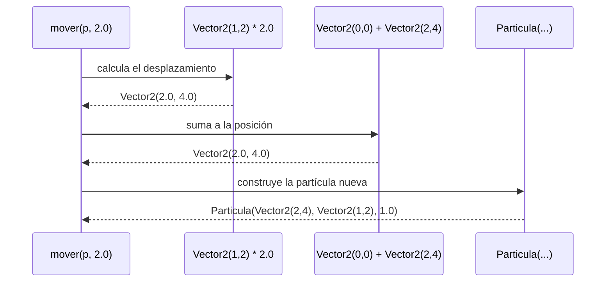

# Informe de proceso

## 1. `mover`

### Definición del algoritmo

```scala
def mover(p: Particula, dt: Double): Particula = {
  Particula(p.pos + p.vel * dt, p.vel, p.masa)
}
```

* La función `mover` calcula dónde queda una partícula después de un intervalo
  de tiempo `dt`.
* Recibe dos parámetros:

  * `p`: la partícula, con su posición `pos`, su velocidad `vel` y su `masa`.
  * `dt`: el intervalo de tiempo que avanza la simulación.
* No modifica `p`: construye una **partícula nueva**. La posición cambia; la
  velocidad y la masa se copian tal cual.
* La función **no es recursiva**: es una sola expresión que se evalúa en un
  número fijo de pasos, sin importar los datos de entrada.

### Explicación paso a paso

La posición nueva sigue la ecuación del movimiento rectilíneo uniforme:

```math
\vec{p}\,' = \vec{p} + \vec{v} \cdot dt
```

Las operaciones `+` y `*` son métodos de `Vector2`, definidos en `Modelo.scala`:

```scala
def +(o: Vector2): Vector2 = Vector2(x + o.x, y + o.y)
def *(k: Double): Vector2 = Vector2(x * k, y * k)
```

Por la precedencia de operadores de Scala, `*` se evalúa antes que `+`:

```scala
p.pos + p.vel * dt   ==   p.pos.+(p.vel.*(dt))
```

Entonces, la evaluación ocurre en este orden:

1. `p.vel * dt`: se escala la velocidad por el tiempo (el desplazamiento).
2. `p.pos + (...)`: se suma el desplazamiento a la posición.
3. `Particula(...)`: se construye la partícula nueva con la posición nueva,
   la misma velocidad y la misma masa.

---

### Evaluación con el modelo de sustitución

Ejemplo:

```scala
val p = Particula(Vector2(0, 0), Vector2(1, 2), 1.0)
mover(p, 2.0)
```

#### Paso 1: Llamada inicial

```scala
mover(Particula(Vector2(0, 0), Vector2(1, 2), 1.0), 2.0)
```

#### Paso 2: Se reemplaza el cuerpo de la función

```scala
Particula(Vector2(0, 0) + Vector2(1, 2) * 2.0, Vector2(1, 2), 1.0)
```

#### Paso 3: Se evalúa `*` (desplazamiento)

```scala
Vector2(1, 2) * 2.0  →  Vector2(1 * 2.0, 2 * 2.0)  →  Vector2(2.0, 4.0)
```

#### Paso 4: Se evalúa `+` (posición nueva)

```scala
Vector2(0, 0) + Vector2(2.0, 4.0)  →  Vector2(0 + 2.0, 0 + 4.0)  →  Vector2(2.0, 4.0)
```

#### Paso 5: Se construye la partícula resultado

```scala
Particula(Vector2(2.0, 4.0), Vector2(1, 2), 1.0)
```

---

### Pila de llamados

Como `mover` no es recursiva, la pila nunca crece más allá de tres niveles:
la llamada a `mover`, y dentro de ella, una llamada a `*` y luego una a `+`.
Cada una termina antes de que empiece la siguiente.



---

### Ejemplo de uso

```scala
val p = Particula(Vector2(0, 0), Vector2(1, 2), 1.0)
val q = mover(p, 2.0)
println(q.pos)  // Vector2(2.0,4.0)
println(p.pos)  // Vector2(0.0,0.0), p no cambió
```

El resultado de `mover(p, 2.0)` es una partícula en `(2, 4)` con la misma
velocidad `(1, 2)` y la misma masa `1.0`. La partícula original sigue igual.
