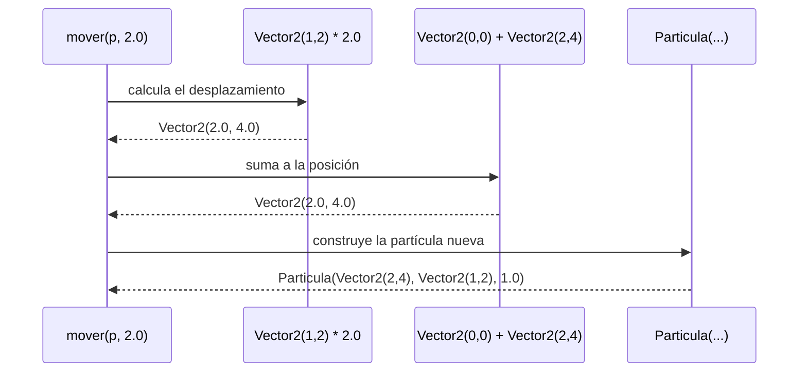
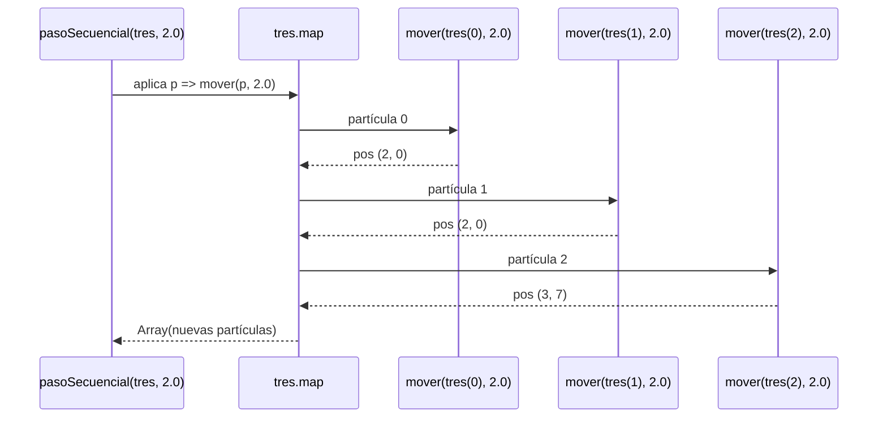

# Informe de proceso

## 1. `mover`

### Definición del algoritmo

```scala
def mover(p: Particula, dt: Double): Particula = {
  Particula(p.pos + p.vel * dt, p.vel, p.masa)
}
```

* La función `mover` calcula dónde queda una partícula después de un intervalo
  de tiempo `dt`.
* Recibe dos parámetros:

  * `p`: la partícula, con su posición `pos`, su velocidad `vel` y su `masa`.
  * `dt`: el intervalo de tiempo que avanza la simulación.
* No modifica `p`: construye una partícula nueva. La posición cambia; la
  velocidad y la masa se copian tal cual.
* La función no es recursiva: es una sola expresión que se evalúa en un
  número fijo de pasos, sin importar los datos de entrada.

### Explicación paso a paso

La posición nueva sigue la ecuación del movimiento rectilíneo uniforme:

```math
\vec{p}\,' = \vec{p} + \vec{v} \cdot dt
```

Las operaciones `+` y `*` son métodos de `Vector2`, definidos en `Modelo.scala`:

```scala
def +(o: Vector2): Vector2 = Vector2(x + o.x, y + o.y)
def *(k: Double): Vector2 = Vector2(x * k, y * k)
```

Por la precedencia de operadores de Scala, `*` se evalúa antes que `+`:

```scala
p.pos + p.vel * dt   ==   p.pos.+(p.vel.*(dt))
```

Entonces, la evaluación ocurre en este orden:

1. `p.vel * dt`: se escala la velocidad por el tiempo (el desplazamiento).
2. `p.pos + (...)`: se suma el desplazamiento a la posición.
3. `Particula(...)`: se construye la partícula nueva con la posición nueva,
   la misma velocidad y la misma masa.

---

### Evaluación con el modelo de sustitución

Ejemplo:

```scala
val p = Particula(Vector2(0, 0), Vector2(1, 2), 1.0)
mover(p, 2.0)
```

#### Paso 1: Llamada inicial

```scala
mover(Particula(Vector2(0, 0), Vector2(1, 2), 1.0), 2.0)
```

#### Paso 2: Se reemplaza el cuerpo de la función

```scala
Particula(Vector2(0, 0) + Vector2(1, 2) * 2.0, Vector2(1, 2), 1.0)
```

#### Paso 3: Se evalúa `*` (desplazamiento)

```scala
Vector2(1, 2) * 2.0  →  Vector2(1 * 2.0, 2 * 2.0)  →  Vector2(2.0, 4.0)
```

#### Paso 4: Se evalúa `+` (posición nueva)

```scala
Vector2(0, 0) + Vector2(2.0, 4.0)  →  Vector2(0 + 2.0, 0 + 4.0)  →  Vector2(2.0, 4.0)
```

#### Paso 5: Se construye la partícula resultado

```scala
Particula(Vector2(2.0, 4.0), Vector2(1, 2), 1.0)
```

---

### Pila de llamados

Como `mover` no es recursiva, la pila nunca crece más allá de tres niveles:
la llamada a `mover`, y dentro de ella, una llamada a `*` y luego una a `+`.
Cada una termina antes de que empiece la siguiente.



---

### Ejemplo de uso

```scala
val p = Particula(Vector2(0, 0), Vector2(1, 2), 1.0)
val q = mover(p, 2.0)
println(q.pos)  // Vector2(2.0,4.0)
println(p.pos)  // Vector2(0.0,0.0), p no cambió
```

El resultado de `mover(p, 2.0)` es una partícula en `(2, 4)` con la misma
velocidad `(1, 2)` y la misma masa `1.0`. La partícula original sigue igual.

---

## 2. `pasoSecuencial`

### Definición del algoritmo

```scala
def pasoSecuencial(s: Sistema, dt: Double): Sistema = {
  s.map(p => mover(p, dt))
}
```

* La función `pasoSecuencial` avanza todo el sistema un intervalo de
  tiempo `dt`.
* Recibe dos parámetros:

  * `s`: el sistema, que es un `Array[Particula]`.
  * `dt`: el intervalo de tiempo.
* Usa `map`, que aplica una función a cada elemento del arreglo y devuelve un
  arreglo nuevo del mismo tamaño, con los resultados en el mismo orden.
* La función que se aplica es la lambda `p => mover(p, dt)`: "a cada
  partícula `p`, muévela `dt`". Por eso `pasoSecuencial` reutiliza `mover`.
* No modifica `s`: el arreglo original queda igual.

### Explicación paso a paso

`map` se comporta como si recorriera el arreglo de izquierda a derecha:

1. Toma la partícula en la posición `0` y la mueve.
2. Toma la partícula en la posición `1` y la mueve.
3. … y así hasta la última.
4. Pone los resultados en un arreglo nuevo, en el mismo orden.

Si `s` está vacío no hay nada que recorrer y el resultado es un arreglo vacío.

Todo esto ocurre en un solo hilo, una partícula después de otra. Por eso
se llama secuencial: el número de pasos crece con el número de partículas
$n$.

---

### Evaluación con el modelo de sustitución

Ejemplo:

```scala
val tres: Sistema = Array(
  Particula(Vector2(0, 0), Vector2(1, 0), 1.0),
  Particula(Vector2(2, 2), Vector2(0, -1), 2.0),
  Particula(Vector2(-1, 3), Vector2(2, 2), 3.0))

pasoSecuencial(tres, 2.0)
```

#### Paso 1: Llamada inicial

```scala
pasoSecuencial(tres, 2.0)
```

#### Paso 2: Se reemplaza el cuerpo de la función

```scala
tres.map(p => mover(p, 2.0))
```

#### Paso 3: `map` aplica `mover` a cada partícula

```scala
Array(
  mover(Particula(Vector2(0, 0),  Vector2(1, 0),  1.0), 2.0),
  mover(Particula(Vector2(2, 2),  Vector2(0, -1), 2.0), 2.0),
  mover(Particula(Vector2(-1, 3), Vector2(2, 2),  3.0), 2.0))
```

#### Paso 4: Se evalúa cada `mover` (como en la sección 1)

```scala
(0, 0)  + (1, 0)  * 2.0  =  (0, 0)  + (2, 0)   =  (2, 0)
(2, 2)  + (0, -1) * 2.0  =  (2, 2)  + (0, -2)  =  (2, 0)
(-1, 3) + (2, 2)  * 2.0  =  (-1, 3) + (4, 4)   =  (3, 7)
```

#### Paso 5: Resultado

```scala
Array(
  Particula(Vector2(2, 0), Vector2(1, 0),  1.0),
  Particula(Vector2(2, 0), Vector2(0, -1), 2.0),
  Particula(Vector2(3, 7), Vector2(2, 2),  3.0))
```

Mismo tamaño (3), mismo orden (masas 1, 2, 3), velocidades y masas iguales;
solo cambiaron las posiciones.

---

### Diagrama de llamados

`map` llama a `mover` una vez por partícula, una después de otra. Cada llamado
termina antes de que empiece el siguiente, así que la pila no crece con el
tamaño del sistema.



---

### Ejemplo de uso

```scala
val r = pasoSecuencial(tres, 2.0)
println(r.map(_.pos).toList)     // List(Vector2(2.0,0.0), Vector2(2.0,0.0), Vector2(3.0,7.0))
println(tres.map(_.pos).toList)  // List(Vector2(0.0,0.0), Vector2(2.0,2.0), Vector2(-1.0,3.0)), tres no cambió
```
